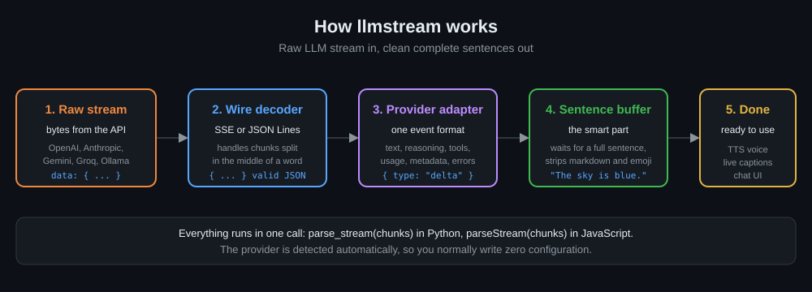
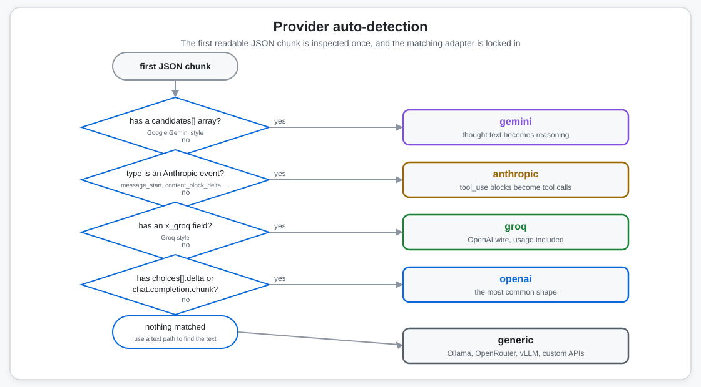
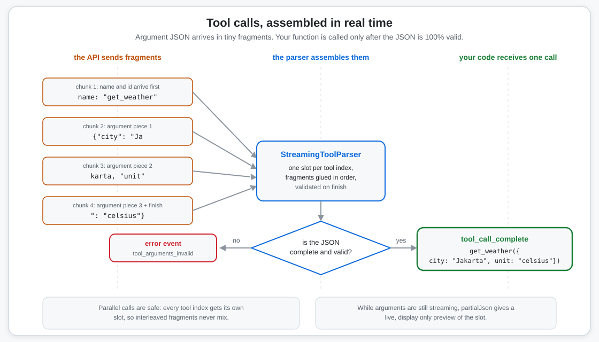
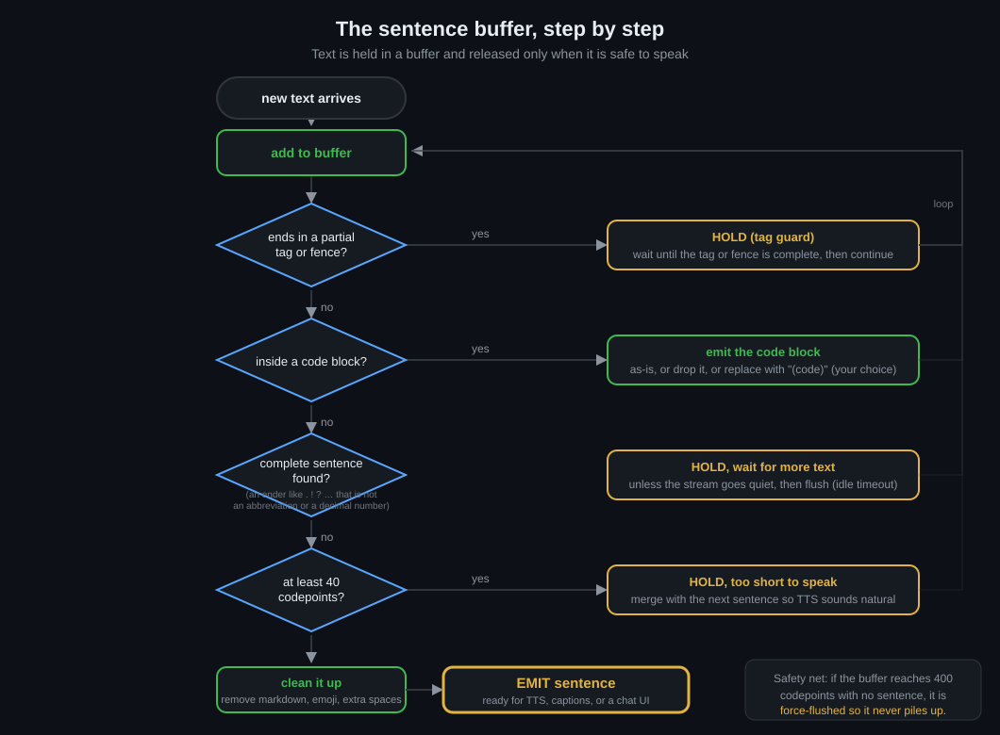

# llmstream (JavaScript / TypeScript)

Parse LLM streaming responses into **clean, complete sentences**, with auto provider detection, zero runtime dependencies, and a single call. Works in browsers, Node, Deno, Bun, Edge Workers, and React.

**Part of the [llmstream](../README.md) monorepo** (Python + JS/TS, spec-first, shared test vectors).

## Install

```bash
npm install llmstream
# React is an *optional* peer dependency, only needed for `llmstream/react`:
npm install react
```

Dual-format build: **ESM + CJS** with bundled type declarations. `sideEffects: false` for tree-shaking.

## How the pipeline works

<p align="center">
  
</p>

## Exports

| Subpath | Contents |
|---|---|
| `llmstream` | Everything: `parseStream`, `parseEvents`, `sentenceTransform`, `wrapStream`, buffer, tool parser, providers, decoders, errors |
| `llmstream/react` | `useLLMStream` hook |
| `llmstream/tool` | `StreamingToolParser`, `partialJson`, `ToolSlot` |

## Quick start

`parseStream` is the one-call entry point. It auto-detects the provider and wire format, and applies the `"voice"` buffer preset (sentence strategy + 500 ms idle flush + markdown/emoji stripping) by default.

```ts
import { parseStream } from "llmstream";

const res = await fetch("https://api.openai.com/v1/chat/completions", {
  method: "POST",
  headers: { Authorization: `Bearer ${API_KEY}` },
  body: JSON.stringify({ model: "gpt-4o-mini", messages, stream: true }),
});

for await (const sentence of parseStream(res.body!)) {
  console.log(sentence);   // each sentence is complete and clean
}
```

`parseStream` accepts anything it can iterate:

- `ReadableStream<Uint8Array>` (e.g. `fetch().body`, Node `Readable` via adapter)
- `AsyncIterable` of `Uint8Array | string` (or pre-parsed JSON objects)
- `Iterable` of `Uint8Array | string` (e.g. a local fixture, file lines)

## The `wrapStream` HOF (the JS "decorator")

Wrap a generator that yields raw chunks so it yields sentences instead:

```ts
import { wrapStream } from "llmstream";

const chat = wrapStream({ buffer: "ui" })((async function* (prompt: string) {
  const res = await fetch(url, { method: "POST", body: JSON.stringify({ prompt, stream: true }) });
  for await (const chunk of res.body!) yield chunk;   // raw SSE bytes
}));

for await (const sentence of chat("Hello!")) {
  console.log(sentence);
}
```

## Web Streams adapter (no loop at all)

```ts
import { sentenceTransform } from "llmstream";

res.body!
  .pipeThrough(sentenceTransform({ provider: "openai", buffer: "ui" }))
  .pipeTo(outputWritableStream);
```

`TransformStream<Uint8Array, string>`: raw bytes in, clean sentences out. One `ParserCore` per stream instance, safe to instantiate per request.

## React: `useLLMStream`

Wraps `fetch` + parsing into a reactive hook with abort, a throttled (~30 fps) live `partial`, validated tool calls, and unmount cleanup:

```tsx
import { useLLMStream } from "llmstream/react";

function Chat() {
  const { sentences, partial, toolCalls, status, error, start, abort, reset } =
    useLLMStream({
      onSentence: (s) => console.log(s),     // each complete sentence as it lands
      onToolCall: (tc) => runTool(tc.name, tc.arguments), // complete JSON only
    });

  return (
    <div>
      {sentences.map((s, i) => <p key={i}>{s}</p>)}
      <span className="partial">{partial}</span>   // live in-progress text
      {status === "streaming" && (
        <>
          <button onClick={() => start("/api/chat", {
            method: "POST",
            headers: { "Content-Type": "application/json" },
            body: JSON.stringify({ messages }),
          })}>Send</button>
          <button onClick={abort}>Stop</button>
        </>
      )}
      {error && <pre>{error.message}</pre>}
    </div>
  );
}
```

State shape:

| Field | Type | Meaning |
|---|---|---|
| `sentences` | `string[]` | Final, complete sentences |
| `partial` | `string` | Live in-progress buffer (throttled ~30 fps) |
| `toolCalls` | `ToolCall[]` | Fully assembled, validated tool calls |
| `status` | `"idle" \| "streaming" \| "done" \| "error"` | Lifecycle |
| `error` | `Error \| null` | Last error (when `status === "error"`) |
| `start(url, opts)` | `() => Promise<void>` | Start a stream (opts: `method`, `headers`, `body`, `provider`, `buffer`, `signal`) |
| `abort()` | `() => void` | Abort the current stream |
| `reset()` | `() => void` | Clear all state |

Starting a new stream while one is in flight aborts the previous one automatically; unmounting cleans up.

## Working with raw events

`parseStream` yields **sentences** (string). Use `parseEvents` for the normalized `StreamEvent` stream (tool calls, usage, metadata, errors):

```ts
import { parseEvents } from "llmstream";

for await (const ev of parseEvents(res.body!, { provider: "auto" })) {
  switch (ev.type) {
    case "delta":
      print(ev.text);
      break;
    case "reasoning_delta":
      thinking += ev.text;
      break;
    case "tool_call_complete":
      runTool(ev.name, ev.arguments);   // validated JSON object
      break;
    case "usage":
      log(ev.inputTokens ?? ev.outputTokens);
      break;
    case "metadata":
      console.log(ev.model, ev.finishReason);
      break;
    case "error":
      console.error(ev.code, ev.message);
      break;
    case "done":
      break;
  }
}
```

`StreamEvent` fields (union by `type`): `text` (delta/reasoning_delta) · `index`, `id`, `name`, `argumentsDelta` (tool_call_delta) · `index`, `id`, `name`, `arguments`, `rawArguments` (tool_call_complete) · `inputTokens`, `outputTokens`, `totalTokens` (usage) · `provider`, `model`, `finishReason`, `raw` (metadata) · `code`, `message`, `providerError` (error).

## Providers

Auto-detected from the first parseable payload (same order as Python): `candidates[]` → **gemini**; Anthropic `type` set → **anthropic**; `x_groq` → **groq**; `choices[].delta` / `object === "chat.completion.chunk"` → **openai**; otherwise → **generic** (Ollama, OpenRouter, vLLM, any OpenAI-compatible endpoint).

<p align="center">
  
</p>

Override when you know better:

```ts
parseStream(res.body!, { provider: "groq" });

// Generic adapter with a custom dotted text path (e.g. Ollama):
parseEvents(res.body!, { provider: "generic", textPath: "message.content" });

// Force the wire format:
parseStream(res.body!, { streamFormat: "jsonl" });
```

## Tool calls

The pipeline assembles fragmented tool-call arguments **per slot (by index)** and emits `tool_call_complete` **only after strict JSON validation**. Empty arguments become `{}`. Invalid JSON produces an `error` event (`code: "tool_arguments_invalid"`) instead of a broken call.

<p align="center">
  
</p>

Low-level access (subpath `llmstream/tool`):

```ts
import { StreamingToolParser, partialJson } from "llmstream/tool";

const parser = new StreamingToolParser();

parser.onToolCallDelta(ev, (index, partial) => {
  console.log("assembling...", partial);   // live preview (display only)
});

const complete = parser.finalize();     // all slots, ascending index
console.log(complete[0].name, complete[0].arguments);
```

`partialJson('{"a": 1, "b": ')` becomes `{"a": 1, "b": null}`: best-effort, **display-only** completion that never gates dispatch.

## Buffer options

`buffer` accepts a preset (`"voice"`, `"ui"`, `"off"`/`false`) or a `BufferOptions` object:

```ts
import { parseStream, PRESET_VOICE } from "llmstream";

const opts = {
  minChunkSize: 40,          // don't flush sentences shorter than this (codepoints)
  maxBufferSize: 400,        // force-flush ceiling so the buffer never piles up
  idleTimeoutMs: 500,        // flush after 500ms of silence (async pipelines only)
  strategy: "sentence",      // "sentence" | "clause" | "fixed" | `regex:${pattern}`
  sentenceEnders: ". ! ? … 。 ！",   // NOTE: spaces are separators, not boundary chars
  softBoundary: ", ; : —",
  stripMarkdown: true,
  stripEmoji: true,
  collapseWhitespace: true,
  guardTags: ["```", "~~~", "`"],
  guardTagsExtra: ["<pause>", "[laugh]"],
  codeBlockMode: "passthrough",   // "passthrough" | "drop" | "sanitize" ("(code)")
  additionalAbbrevs: ["vs", "etc", "approx"],
  on_error: "raise",         // "raise" | "skip"
};

for await (const s of parseStream(res.body!, { buffer: opts })) { ... }
```

> **snake_case accepted:** for cross-language convenience the JS API also accepts the Python-style keys (`min_chunk_size`, `max_buffer_size`, `idle_timeout` in **seconds**, `sentence_enders`, `guard_tags_extra`, `code_block_mode`, `additional_abbrevs`, `stream_format`, `text_path`, `tool_path`). They are normalized before use, and the shared test vectors run unmodified on both runtimes.

**How the buffer works** (full normative spec: [../spec/BUFFER-ALGORITHM.md](../spec/BUFFER-ALGORITHM.md)):

1. Text accumulates; a sentence boundary is a valid ender (`.!?…。！`) **not** part of an abbreviation (Rule A) **not** a decimal/token dot (Rule U), followed by whitespace/EOF/closing punctuation (Rule F).
2. A flushed region must be at least `minChunkSize` codepoints, otherwise held for the next boundary.
3. At `maxBufferSize` with no valid boundary, the buffer is force-flushed (cut at the limit).
4. **Tag guard**: buffer ending in a proper prefix of a guarded tag (`` ` ``, a fence, `<pause>`...) is withheld until the tag completes.
5. **Idle timeout** (async `parseStream` only): a paused stream with held text is flushed, keeping output latency low.

<p align="center">
  
</p>

`SentenceBuffer` is exported for standalone use:

```ts
import { SentenceBuffer } from "llmstream";

const buf = new SentenceBuffer(PRESET_VOICE);
for (const s of buf.feed("The quick brown fox")) { ... }   // [] (not a sentence yet)
for (const s of buf.feed(" jumps. Then it ran fast.")) console.log(s);
for (const s of buf.close()) console.log(s);               // trailing partial
```

## Error handling

- `on_error: "raise"` (default): malformed chunks throw `ProtocolError`; bad tool JSON throws `ToolArgumentsError`; provider errors throw `ProviderError`. All extend `LLMStreamError`.
- `on_error: "skip"`: errors are emitted as `error` events (`code` in `malformed_chunk`, `tool_arguments_invalid`, `provider_error`) and the stream continues.

```ts
import { LLMStreamError } from "llmstream";

try {
  for await (const ev of parseEvents(res.body!)) { ... }
} catch (e) {
  if (e instanceof LLMStreamError) console.error(e.name, e.message);
  else throw e;
}
```

## Tests

```bash
cd js
npm install
npm test           # vitest: 53 tests, the same shared vectors as Python
npm run typecheck  # tsc --noEmit
npm run build      # tsup -> dist/ (ESM + CJS + .d.ts)
```

## Module map

| Module | Contents |
|---|---|
| `src/pipeline.ts` | `parseStream`, `parseEvents`, `sentenceTransform`, `wrapStream`, `ParserCore` |
| `src/buffer.ts` | `SentenceBuffer`, `sanitizeForTts`, `withholdLen` |
| `src/toolParser.ts` | `StreamingToolParser`, `partialJson`, `ToolSlot` |
| `src/providers.ts` | all five adapters, `detectProvider`, `createAdapter`, `resolvePath` |
| `src/decoders.ts` | `SSEDecoder`, `JsonLinesDecoder` (incremental, UTF-8-safe) |
| `src/types.ts` | `StreamEvent`, `BufferOptions`, presets, codepoint helpers, snake_case normalization |
| `src/errors.ts` | `LLMStreamError` hierarchy |
| `src/react/useLLMStream.ts` | the React hook |